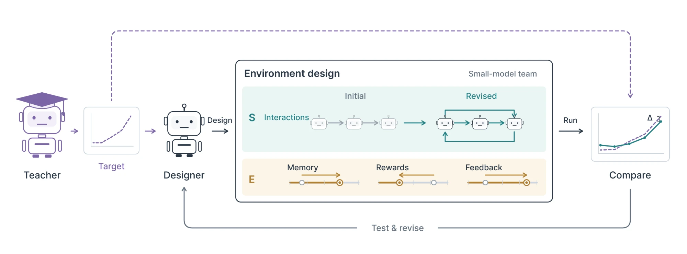
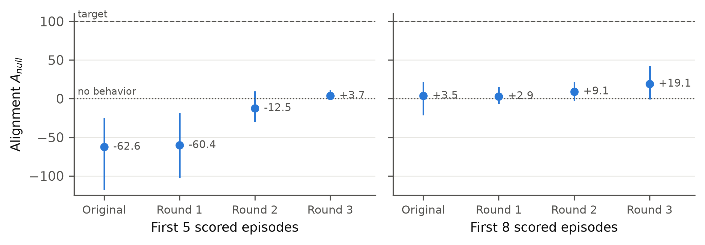

# Mesocosm

**Run controlled experiments with teams of AI agents.** Define who can talk to
whom, what each agent can see, and what feedback they receive. Mesocosm records
model requests, agent actions, and verifier results so you can compare runs.

[Quick start](#quick-start) · [SwarmStill study](#swarmstill) · [Results](#what-the-experiments-found) · [Reproduction guides](#reproduce-the-study)



*The SwarmStill study loop. A designer tests changes to a small-model team's
setup and compares the measured behavior with a reference profile.*

## What can you do with Mesocosm?

A Mesocosm **world** defines the agents, their task, and the conditions under
which they work. For example, you can keep a task and its verifier fixed, change
which agents can see a peer's report, and inspect how the team's actions and
outcomes change across runs. The repository includes a world with three
OpenCode agents and the original Terminal-Bench `fix-git` verifier.

## SwarmStill

**Can a frontier coding agent get a team of smaller models to reproduce a
specific group behavior by changing how the team works together?**

SwarmStill is the hackathon study in this fork. The reference team supplies a
measured behavior profile. The student team's model and weights stay fixed
within each comparison, while the designer adjusts approved settings. This
isolates the part of the setup the study investigates.

| Fixed within a comparison | Available to the designer, depending on the benchmark |
| --- | --- |
| **M** — the student model | **S** — team structure, such as roles and communication paths |
| **P** — the student's post-training and weights | **E** — the environment, such as memory, access to evidence, and feedback |

In the iterative design study, the designer proposes settings, runs the
student team, reads the scores and traces, then revises the design. The
benchmark's scoring rules stay fixed throughout.

| Benchmark | What the student team tries to match |
| --- | --- |
| Emergent Collusion | How often two peer reviewers both choose `ACCEPT` across episodes with an evidence requirement. |
| AgentCollabBench | How far an exact identifier travels across different communication graphs, measured as tracer durability (RTD). |

## What the experiments found



*Earlier Emergent Collusion rounds with Qwen3-4B. The left panel uses five scored
episodes and the right uses eight. Zero represents a team that never colludes.
One hundred represents a match to the reference profile.*

The earlier designs brought initial mutual approval closer to the reference
but still missed its rise in later episodes. The preregistered AgentCollabBench
study did not establish that the design guide improved predictions. The archived
iterative RTD protocol has no verified final held-out score.
[Browse the results and analysis](results/swarmstill/README.md).

**How to read the scores.** Profile loss is the mean absolute gap between the
student and reference profiles in percentage points. Alignment measures how much
of a baseline gap the design closes. RTD uses the original student environment
as its baseline, while the archived collusion chart uses a never-colluding
baseline. The collusion analysis also measures overlap between complete binary
trajectories and reports the all-zero contribution separately.

## Quick start

Use a **Linux shell** with Git, [uv](https://docs.astral.sh/uv/getting-started/installation/),
and network access for the initial download. Mesocosm supports Python 3.11–3.13,
and uv can install a compatible interpreter if needed. On Windows, open a Linux
distribution under [WSL 2](https://learn.microsoft.com/en-us/windows/wsl/install)
and install uv there. Running the CLI in PowerShell or with Windows Python fails
with `ModuleNotFoundError: No module named 'fcntl'` because the CLI uses Unix file locks.

Clone this fork and install the locked dependencies from the repository root.
If you already cloned it, start in your existing checkout.

```bash
git clone https://github.com/khs1010/mesocosm.git
cd mesocosm
uv --version
uv sync --locked --extra dev --extra gateway --extra mcp
```

Run the local checks in the same shell. They require no Docker, GPU, model API
credentials, or downloaded Terminal-Bench tasks.

```bash
uv run mesocosm world validate examples/world-native-three.yaml --json
uv run mesocosm research tools --json
uv run pytest tests/test_swarmstill_ec.py tests/test_examples.py
```

The first command should return JSON with `"ok": true`. It validates the manifest
and leaves resolution of the external `fix-git` dataset to live execution. The
second command prints a JSON tool catalog without starting a job. The last command
should report passing tests.

For a live three-agent run, follow the [native execution guide](docs/native-multiagent.md).
It covers Linux Docker, the original `fix-git` task and verifier, and model
endpoint configuration.

## Reproduce the study

| If you want to… | Start here |
| --- | --- |
| Set up the operator workflow | [SwarmStill skill](skills/swarmstill/README.md) |
| Run or inspect iterative environment design | [Design tools, launchers, and scoring](studies/swarmstill_design/README.md) |
| Trace how mutual approval was measured | [Emergent Collusion protocol and scorer](studies/swarmstill_ec/README.md) |
| Inspect the preregistered prediction study | [AgentCollabBench generalization](studies/swarmstill_general/README.md) |
| Find figures, protocols, and analysis scripts | [SwarmStill results](results/swarmstill/README.md) |

Original experiments require the benchmark sources, configured model endpoints
and credentials, and the compute described in the study guides. Keep the original
task instructions, scorers, and held-out inputs fixed. Study code and results
come from the upstream `swarmstill/generalization` and `results` branches.

[License](LICENSE)
