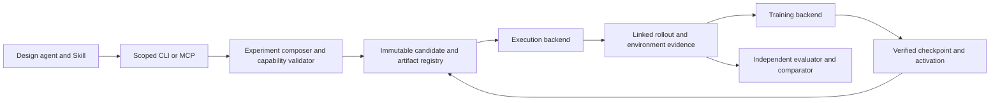

# SwarmStill P/S/E design and experiment workflow

This is the target architecture. The status table below distinguishes native primitives,
the restricted designer profile and proposed work. A schema field or plugin registration
does not establish execution support. The [mutable-P implementation](designer-policy.md)
is one part of this workflow, not a claim that all features below already run.

## One experiment core, multiple access profiles

The skill guides an agent through discover → compose → validate → run/train → compare.
CLI and MCP are clients of the same typed Mesocosm implementation. Keep canonical runtime
semantics in `WorldManifest`, installed execution/task integrations, learning configuration
and frozen evaluators; a P/S/E view must compile to these types rather than duplicate them.

The research-designer profile may select approved models, role/population templates, tasks,
tools and independent evaluator handles. The blinded-inverse profile restricts those choices
to the study's released domains and masks teacher conditions and private interventions.
Private credentials, host paths and operator control are never public inputs in either profile.
Fixed P is a study choice. It is not a universal restriction of the skill.



## P: who acts and which weights change

Represent a model/checkpoint/tokenizer as pinned artifacts, and an adapter as a child of an
exact base. Bind each stable agent slot to a policy reference. Three identical references
mean shared immutable weights, not shared conversations. One adapter plus two base references
expresses the mixed population without rewriting agent prompts.

A training group identifies contributing rollout agents, the dataset selection, the parent
policy, optimizer method/parameters, update targets and hard budget. Updating a shared parent
creates a new immutable policy. Only the declared target slots move to the new checkpoint.
This separates "learn from A and B" from "update A and B". Each group records whether it owns
one shared optimizer/adapter or separate jobs. Changes happen at an enforced episode/world
boundary; unsupported mid-turn weight replacement must fail.

The training adapter consumes preserved observation/action boundaries and the selected E
reward/feedback receipt. SFT uses demonstration targets; RL consumes actual action log
probabilities, rewards and any method-required reference/value/group records. PPO requires
its actual clipped objective and optimization; GRPO requires real grouped rollouts and
relative advantages. Neither name can be implemented by prompt instructions, changing an
SFT label or renaming REINFORCE. Training acceptance requires optimizer updates and committed
checkpoint hashes; activation and behavioral improvement are separate evidence.

## S: population, information graph and execution order

Population templates declare N stable agents, role/template references, teams and task
assignment. Roles determine reviewed instructions, capabilities and workflow responsibilities;
they cannot be a free-text route to prescribe the target behavior in a blinded study.
The research profile can select approved templates; the inverse profile can narrow this set.
Minimum agent count is backend-specific: current native worker research acceptance requires
at least three real agents. Preserve an original two-agent task's protocol rather than
adding a participant simply to pass admission; it needs a compatible execution contract.

Separate three graphs:

| Graph | Meaning | Example |
|---|---|---|
| Visibility | Which principal can send/read each message or resource type | A→B→C, public channel, private DM |
| Work/review | Which task/artifact is assigned to which worker/reviewer | Many workers report to one reviewer |
| Scheduling/decision | Which completion/approval unlocks the next turn and who commits a final result | Parallel workers → reviewer → designated final decider |

Enforce visibility at delivery/read time with ACLs and sandbox/network policy, not a prompt
asking an agent to ignore messages. Record send, recipient set, actual read and authorization
receipt. Channel membership is different from observing a particular message. A permitted
cache, board, repository or internet path may relay information and must enter the access graph.

A scheduler must enforce concurrency, turn order, rounds, deadlines, required review edges
and decision authority at actual harness admission/commit. Asking an agent to "wait" is not
sequential execution. A peer's accept/reject is an operational signal, not the independent
task verifier or a ground-truth behavior label. An unsupported schedule should be rejected
before allocating a run, rather than approximated through authored task prose.

## E: task, tools, state, feedback and reward

Select original task sources and evaluator contracts through installed, pinned integrations.
Task/tool/verifier adapters own their real protocols and lifecycle. Uploaded experiment
content never becomes an import path or installs code. Integration authors implement and
calibrate a trusted provider separately; unsupported original contracts remain unsupported.

E declares tool/service permissions, input visibility, read/write grants, shared state,
history selection/length, feedback recipients/delay and reset policy. Reset semantics name
the actual state: task workspace, shared service, cache/repository, history, harness session
and training optimizer. "Fresh task filesystem" must not imply every state was reset.
State carry/restore requires a backend checkpoint contract for each retained component.

E defines measured individual/team reward allocation and feedback. P defines the algorithm
that consumes those signals to update weights. Keep original task score, allocated reward,
feedback delivered, reviewed violations and independent behavior detector output separate.
No auxiliary detector silently replaces the task scorer or enters reward unless declared.

## Immutable definition and mutable lifecycle

The logical P/S/E view below is illustrative, not an executable current manifest:

```yaml
experiment:
  task_set: tasks-original-pinned
  evaluator: behavior-detector-frozen
  P:
    bindings: {worker-a: adapter-a, worker-b: base-a, reviewer: base-a}
    update_groups:
      - sources: [worker-a, worker-b]
        parent: base-a
        targets: [worker-a]
        dataset: demonstrations-approved
        method: sft_lora
        budget: {steps: 100, seconds: 600}
  S:
    population_template: two-workers-one-reviewer
    visibility: {edges: [[worker-a, reviewer], [worker-b, reviewer]]}
    schedule: {workers: parallel, after: reviewer, final_decider: reviewer}
  E:
    permissions: permissions-approved
    memory: {history_episodes: 2, reset: fresh_world}
    rewards: {allocation: mixed, team_weight: 0.5}
    feedback: {recipients: actors, delay_episodes: 1}
  run_plan: {repetitions: 5, order_seed: 42, budget: runtime-approved}
```

Freeze source versions, provider code locks, P bindings/checkpoints, normalized S/E,
task IDs/splits, original verifier, behavior evaluator and budgets in a candidate identity.
Run and training jobs refer to this identity; lifecycle state never mutates its meaning.
Every trial gets an idempotent ID. Retain scheduled, failed, cancelled and missing trials.
Persist source/parent links from model request → tool result → observation/read → action →
artifact → verifier/reward → training checkpoint → next candidate.

Admission must also compare P training provenance with E task/evaluation partitions.
Freeze train/development/held-out task IDs and connected incident/task/session groups,
source hashes and selection rules. Reject known held-out reuse in training or checkpoint
selection and report known overlap or unknown contamination explicitly. Keep test examples
and results outside the designer/trainer selection path. Disjoint IDs or hashes do not
prove semantic novelty; source review and benchmark-specific leakage checks remain necessary.

## Discover, validate, execute and compare

| Stage | Required contract |
|---|---|
| Discover | P/S/E paths, exact types/domains, backend enforcement, prerequisites and evidence; focused paged schemas and reference-log search |
| Compose | Apply typed changes to a base, return normalized effective configuration, changes and immutable candidate hash |
| Validate | Check schema, cross-field compatibility, original integration contract, resources and pinned inputs before admission |
| Execute | Smoke and bounded repetition plans, runtime/training job status, explicit cancellation and owned recovery |
| Compare | Same frozen task/evaluator contracts, actual applied P/S/E and checkpoints, complete denominators and linked trajectories |

Expose these through small tool groups, not all raw schemas and records on every turn.
Current native `describe_tool`, filtered `list_factors`, `configure_experiment`,
`validate_experiment`, `run_experiment`, `get_job_status`, `evaluate_collective` and
`export_reproducer` are reusable foundations. The restricted policy tools add real training
and activation without handing the designer the operator workbench. A unified profile-aware
composer/run/comparison façade remains proposed work.

Diagnostics should identify a code, public setting paths, the blocked combination,
required predicates and valid alternatives. For example: a random-ring review needs enabled
ratings review and chat; a mixed P population needs one compatibility group; a GRPO request
needs a backend advertising grouped-rollout optimization. Diagnostics in blinded mode use
released domains and static requirements, not hidden baseline values or private exceptions.

Distinguish validation levels: configuration validity, venue readiness and execution
acceptance. A green configuration check is not a GPU probe or successful task execution.
Record each requirement's enforcement owner and evidence. Capability states are exactly
`supported`, `unsupported` or `unverified`, scoped to the selected backend/profile.

Job recovery continues the same durable operation or starts an explicitly declared new
attempt. It does not silently replay completed tasks or resume an uncaptured agent process.
Training resume additionally preserves optimizer, RNG, data cursor and cumulative budgets.
Physical process/session rewind is unsupported without explicit backend evidence.
Cancellation needs an acknowledgement and an owned-resource cleanup receipt, not only a
requested flag. Block the next trial if cleanup is failed or unknown; persistent externally
managed model venues retain their explicitly declared ownership/lifetime.

For intervention comparisons, freeze the task set, evaluator and all non-intervened fields.
Patch only declared paths, such as cache write permission, memory length or reward allocation.
Record effective changes and fresh/carry state per trial. Use explicit known/unknown coverage
and numerator/denominator counts; repeated runs on one task set do not establish independent
samples. Reserve a private intervention before blinded designer access and compare teacher
and student response direction on that intervention using the same detector.
For learning during a trial, freeze the initial policy and update protocol rather than
claiming its weights are fixed. Record every applied checkpoint and its training sources
per phase. Declare checkpoint selection using development evidence before held-out access;
do not choose a convenient checkpoint from the hidden-intervention result.

## Implementation status and next work

| Area | Existing foundation | Remaining implementation/acceptance |
|---|---|---|
| P selection/mixed adapters | Native immutable deployment binding and optional restricted policy handles | Live student serving; heterogeneous base/venue mixtures remain unsupported |
| SFT/LoRA | Actual local durable training, checkpoint provenance and optional designer entry points | Full teacher/student loop and trained student serving acceptance |
| RL | Separate native REINFORCE rollout/update contract | PPO/GRPO training providers and their original rollout/optimizer evidence; no current support claim |
| N/roles/tasks | Optional approved role-template population composer and team ACL expansion; task sources remain operator-owned | Approved task/tool catalog and live population acceptance |
| Communication/permissions | Optional public-slot visibility/work graph compiler, service/channel/DM/artifact ACL enforcement | New real-agent acceptance; permission is not proof of exposure |
| Scheduling/review/final decision | Optional task-stage DAG, exact graph review assignments, cleanup-gated stage release and finalizer-only original grading | Native Docker comparison/reset/all/as-ready subset; graph reward/feedback/history/reputation barriers and shared tasks unsupported; live acceptance unverified |
| Resources/history/rewards | Native budgets, history, feedback, reward allocation and state controls | Unified scoped discovery/diagnostics and precise reset capabilities per provider |
| Run/recover/compare | Optional designer development prepare/run/status/compare facade, same-job recovery, fixed task/verifier/budget identity and all-planned-trial accounting | Existing approved worker required; strict whole-run wall-clock unsupported; actual acceptance and hidden-intervention outcomes unverified |

The optional [structure](designer-structure.md) and [development execution](designer-execution.md)
profiles implement the bounded initial compiler/runtime/facade subset above. Extend provider
capabilities and graph combinations only with actual enforcement. Add PPO/GRPO only as real training providers. For every
increment, test software invariants and separately run fresh actual designers plus original
multi-agent tasks. Preserve limitations in the capability matrix; do not fill them with prompts.
